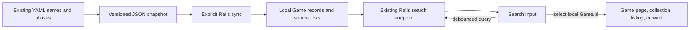

# Marketplace search MVP

> Archived completed MVP plan. Use the [name snapshot guide](../../name-snapshot.md)
> and [consumer index](../../consumers/README.md) for current operation.

The names-only MVP described here remains complete. The owner's subsequent
September 20 instruction prioritizes [stock cover images](../../cover-images.md) for
the next integration. Its coverage gate applies to image-enabled applications;
this historical MVP's optional-image scope no longer defines launch readiness.

Reprioritized September 20, 2026 at the owner's request: unblock work on
`boardgame-marketplace` with suggestions that update while someone types, plus
the minimum behavior needed to select and use a game. This sequence takes
priority over completing the fifty-game editorial pilot. The export and Rails implementation are built, tested, and adopted by the
existing marketplace development database. **This local MVP is complete.** See the
[handoff](session-handoff.md) for current adoption status and the
[name snapshot guide](../../name-snapshot.md) for the implemented contract.

The owner also requires **Django support**. The export contract is framework-neutral;
Rails is the first application adapter, and Django consumes the same JSON artifact.

## Smallest useful delivery

Generate a versioned, framework-neutral, read-only JSON name snapshot from the
existing authoritative YAML. For the first integration, sync it into the
marketplace's PostgreSQL database and reuse Rails'
`GET /games/search?q=...` and existing Stimulus picker. The marketplace serves
suggestions and game detail from its local records. It can keep working when
the catalog application is stopped.

The owner confirmed **local development first**. The same design supports a
hosted Rails deployment by supplying its importer the chosen snapshot during
deployment or an explicit sync. A separately hosted catalog service is not
required for this milestone. Hosting and unattended refresh can be added when
needed. Live suggestions mean new results as the query changes; catalog data
refreshes when a new snapshot is synchronized.

This is a transitional legacy reference feed. It does not convert legacy rows
into approved revisions or pretend that filename identities are reviewed game
design identities. New editorial contributions still use the existing review
gate. The canonical catalog and later approved releases remain the long-term
direction.

## What the project already supports

Read-only inspection covered marketplace checkout `82bca51` and the already
available `origin/main` at `7f31f91` (eleven commits ahead). The latter preserves
the same core search implementation, prioritizes ordinary marketplace use, and
gates math trades. Nothing was checked out, pulled, run, seeded, or changed in
the marketplace. Implementation should start from its current branch and
recheck these files.

| Evidence in the marketplace | Implication for the MVP |
| --- | --- |
| `app/javascript/controllers/game_search_controller.js` waits 200 ms, fetches `/games/search`, and supports arrows/Enter/Escape | Reuse the picker; complete its behavior rather than building another search UI |
| `app/services/games/catalog_search_service.rb` searches local `Game` records; `app/models/game.rb` already uses PostgreSQL trigram search | Search can run inside Rails with the existing dependency |
| `GamesController#search` returns numeric local `id`, `title`, nullable `year`, `image_url`, and optional `bgg_id` | Preserve this browser-facing shape; catalog source IDs belong in the adapter |
| The selection controller parses `game.id` as an integer; collection, listing, wants, and bids reference local `Game.id` | A string slug or catalog UUID cannot simply replace the result ID |
| `Game` requires a title; basic metadata is nullable and cards/details have conditional rendering/image placeholders | Names can unblock the app before player counts, duration, images, or detailed facts are ready |
| `lib/game_loader.rb` matches by title or YAML `id`, reads an absent `master_list.yaml`, and copies numerous fields | Replace this path with a narrow, source-keyed sync; it is not a safe stable-ID importer |
| The current shared picker has a BGG search/import action | Remove that dependency from the MVP path and its relevant tests; no external search is needed to use synced records |
| Want-list and wanted-bid forms use `collection_select` when no game is preselected | They must continue accepting a selected local ID; replace these full-list controls with the shared picker as part of integration |

Two concrete UI gaps also need implementation: in-flight fetches are not
cancelled or guarded against old responses, and `/games` currently wires typing
to its live filter but not to `game-search#search`, despite an autocomplete test
expecting suggestions. The main browse input and collection picker need working
coverage. Existing autocomplete system tests concentrate on math trades and
BGG imports, which do not establish the required marketplace path.

## Data available now

A read-only scan of this checkout found **4,013 YAML files**, all with a nonempty
lexical name. There are **1,403 alias entries across 1,154 files**: 1,384 valid
strings and 19 malformed entries in 19 files. Those malformed alias entries are
YAML mappings caused by unquoted colon-space text; the exporter must
report and omit those entries rather than stringify them as objects. Valid
primary names remain usable. The scan is structural, not factual verification.

Six names are numeric-only, including `007`. Preserve them as strings. Four
normalized title groups contain multiple records: Bushido, Citadels, Dune, and
Splotch. Preserve separate source identities and inspect those small collision
groups for useful display labels; never merge solely by title. Existing year,
publisher, or edition text can help distinguish them when its meaning is clear.
If a collision cannot be distinguished safely, report it and defer those
ambiguous records rather than block the rest of the feed.

Use `games/*.yaml` for this first feed. Broad discovery lists, cached research,
personal ratings, play history, assets, and AI assessments are not inputs.
The twenty marketplace seed titles are acceptance examples, not a cap on name
coverage or a requirement to finish their full editorial preparation first.

## Required behavior and boundaries

| Need | Minimum implementation |
| --- | --- |
| Names and aliases | Search title and valid aliases; return one suggestion per local game even if several names match |
| Useful ranking | Exact name/alias, prefix, then weaker substring/fuzzy matches; stable ordering for ties; case and punctuation normalization |
| Short/numeric input | Permit nonempty one-character prefix queries so typing `7` can find `7 Wonders`; retain `007` exactly |
| Bounded requests | Maximum query length 200; at most ten suggestions; no entire-catalog download on each keystroke |
| Selection | Clicking or pressing Enter yields an existing local numeric `Game.id` and opens the intended detail/add flow |
| Missing metadata | Title-only rows work throughout; absent year, publisher, image, players, and duration remain absent; use placeholders |
| Reliable UI | Keep the 200 ms debounce; cancel requests and ignore late results; clearing, closing, navigating away, or selecting invalidates pending work |
| Accessible picker | Labeled combobox/listbox, active option and expanded state, keyboard selection, loading/error/no-match feedback, mobile taps |
| Repeat synchronization | Stable source keys, explicit reconciliation with existing games, no duplicate local rows, no replaced primary keys or lost associations |
| Catalog unavailable | Search uses the last successfully synced local dataset; a failed sync leaves it intact |
| Game not found | Offer the existing name-only catalog contribution route as a follow-up; do not fabricate a selected game or silently call BGG |

The keyboard/semantics implementation should follow the
[WAI-ARIA combobox pattern](https://www.w3.org/WAI/ARIA/apg/patterns/combobox/).
Use [AbortController](https://developer.mozilla.org/en-US/docs/Web/API/AbortController)
alongside a request-generation check so only the current query may update the
picker. Render title/alias text safely, including when used in attributes.

## Contract and identity bridge

### Framework-neutral JSON and Django support

Publish one documented JSON contract and a standalone JSON Schema with example
fixtures. Rails and Django must consume the same export without generating
framework-specific variants. Reading and validating it must not require Node,
TypeScript, Zod, a catalog SDK, or a connection to the catalog database.

- Use UTF-8 JSON objects, arrays, strings, numbers, booleans, and explicit `null`
  values only. Document each field's type and optionality. Preserve Unicode
  names and string identifiers, including `007`; never coerce an identifier to
  an integer. Collections use arrays, with `[]` meaning no recorded entries.
- Keep application primary keys, ORM model names, database table names, Rails
  serializers, and Django fixture envelopes out of the artifact. Source IDs
  belong to the shared contract; each application owns its local primary keys.
- Document schema compatibility: consumers reject unsupported major schema
  versions before writing, accept documented optional-field additions, and
  preserve unknown/missing metadata without inventing values. Produce one
  checksum for the exact artifact bytes so Ruby and Python can verify it without
  reproducing language-specific JSON serialization.
- Ship shared fixtures and small Ruby/Python consumption examples. Include a
  Django management-command example showing validation, transactional import,
  stable source-key mapping, and repeat-import behavior for an illustrative
  local model. The application chooses its model names and search endpoint.

| Consumer adapter | Responsibility |
| --- | --- |
| Rails marketplace | Map source IDs to existing `Game.id`, store searchable aliases, and preserve its current autocomplete response |
| Django application | Map the same source IDs to its own model primary keys, store searchable aliases, and return results through its own view/API |
| Shared export | Supply the same names, aliases, identity keys, provenance, version, and checksum to both |

The MVP export acceptance includes parsing the same fixtures with Ruby and
Python and matching source IDs, names, aliases, nulls, and checksums. The Django
reference importer must demonstrate that a repeat import preserves local keys
and creates no duplicates. At the Rails MVP checkpoint no Django app had been selected.
The owner subsequently selected `boardgame-exchange`; its full local adapter and
collection search are now implemented in the [Exchange consumer brief](../../consumers/boardgame-exchange.md). This compatibility work is implemented and verified with Ruby, Python, and
Django; see the name snapshot guide.

### Snapshot content and local identity mapping

The first snapshot needs only `schema_version`, a deterministic `dataset_version`,
source commit/file hashes, counts, and a records array. Each record contains:

- `source_id`: an opaque namespaced filename key, for example
  `legacy_yaml:wingspan`; never derive identity from the displayed title.
- `title`: the preserved primary name.
- `aliases`: valid plain strings, deduplicated for search.
- Optional disambiguation text and basic legacy metadata only where needed;
  no requirement to fill them. The feed records its legacy provenance.

The exporter sorts records, validates the complete artifact, computes its
checksum/version, and writes a new file atomically. It must not rebuild the
working `games.db`, mutate YAML, use the proposal importer's reserved UUIDs as
approved identities, or expose private editorial data. This JSON artifact is
separate from the future complete M4 release format and API.

The marketplace stores a unique source-key-to-`Game.id` link and the imported
dataset version, plus searchable aliases. Its importer stages and validates
the artifact before applying it transactionally. First run produces a
reconciliation report: explicitly map existing local records, flag ambiguous
title/slug matches, and create nonconflicting missing rows. A title or optional
BGG ID alone must not silently merge records. Once linked, repeats update by
source key. Missing optional feed fields never erase richer existing metadata.
Missing source rows do not delete games with collection/listing/want references.

After a filename rename, preserve the old source key with an explicit redirect
or mapping change; do not manufacture a new identity silently. Later reviewed
catalog UUIDs can be attached to these same local games through an explicit
crosswalk. Existing twenty-candidate proposed UUIDs remain reserved for that
future work. A legacy edition-like row must not become a claim about a seller's
physical printing.

## Implementation order and stopping point

1. **Catalog name export.** Add the small snapshot contract, deterministic
   exporter, standalone JSON Schema, report, and shared synthetic fixtures.
   Prove numeric titles, aliases, malformed aliases, and distinct same-name
   records, with Ruby/Python compatibility checks and a minimal Django import
   example. Generate a real local artifact from the existing files. No catalog
   database schema, Auth work, publication worker, public API, or infrastructure
   is needed here.
2. **Marketplace import and search.** Add source links and alias search, replace
   the broad legacy loader for this path, reconcile existing rows without
   changing IDs, and serve the current `/games/search` result shape. Reuse the
   existing PostgreSQL search implementation; add/tune indexes based on query
   measurements rather than a separate search service.
3. **Working selection flows.** Wire the browse input, collection picker, and
   want/bid selectors; fix late responses, keyboard semantics, and missing-data
   states. Replace the BGG action with the catalog's no-match path. Preserve
   existing locally stored external data; no BGG requests are made by this path.
4. **Verify and hand back to marketplace work.** Import twice without new rows;
   type a name or alias, select it, add it to a collection, create a listing,
   and select it for a want/bid. Confirm association IDs survive another sync.

Acceptance includes `Wing` → Wingspan, a known Catan alias → the same Catan
selection, `7` → 7 Wonders, `007` as a string, deterministic duplicate handling,
rapid typing/clearing with reordered network responses, keyboard/mobile use,
and title-only details. A failed import leaves the old dataset searchable, and
searching/selection performs no catalog-server or BGG calls. Measure the existing
roughly four-thousand-row dataset; use p95 search response below 150 ms on local
development as an initial target, with no correctness failures. This is a target,
not a measured claim or a public-launch capacity benchmark.

**MVP is complete when those flows work using this catalog's names and the shared
export's Rails/Django compatibility checks pass.** Stop expanding catalog scope
then and resume marketplace feature development.

Deferred: completing fifty reviewed designs, comprehensive edition mapping,
player/time filters, ratings, taxonomy, image licensing/hosting, new contribution
UX, public search infrastructure, complete SQLite/JSON releases, durable
publication jobs, CDN configuration, rollback/public-history UI, and the full
sourced-correction demonstration. Existing M1/M2 code and importer preparation
remain useful for the later reviewed catalog; they need no restart.
